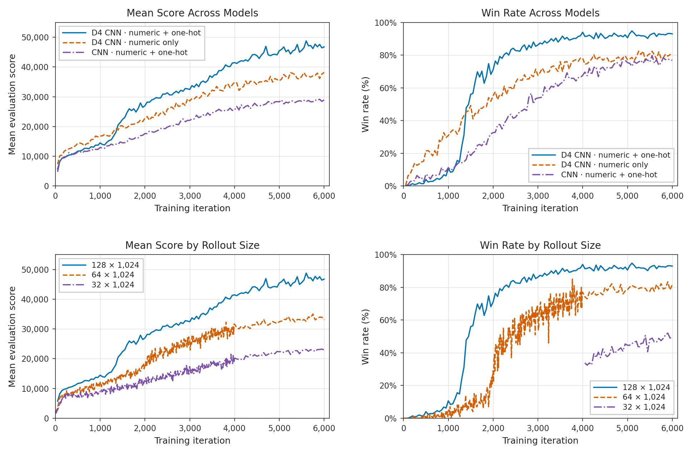
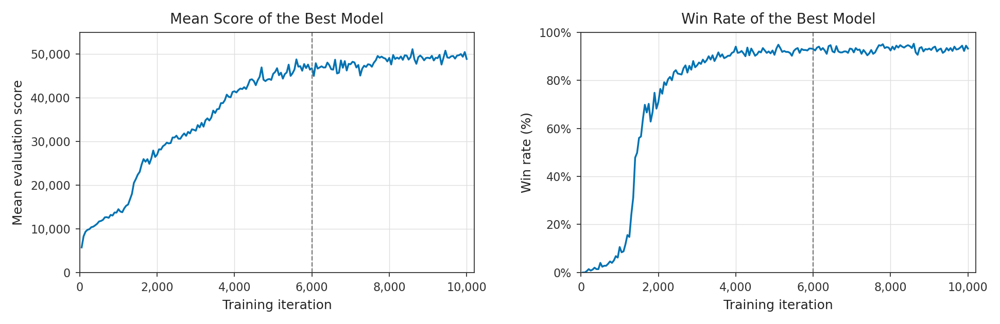

# PPO for 2048

[Play the demo](https://richardbot7000.github.io/ml-playground/) · [Code and training instructions](README.md)

## 1. Goal

The goal of this project was to implement and train a PPO-based algorithm to play 2048. I chose this game since it was always something I wanted to create a bot for. The resulting iterations led to a strategy that achieved almost 50,000 mean score with a 93.2% win rate, where a win means reaching the 2048 tile.

## 2. Initial implementation

I started with a basic PPO implementation, adding standard features such as advantage normalization. I used a CNN model since my intuition was that the 2048 board could be envisioned as an image, where relationships between nearby tiles would be useful for choosing moves. The visible board also contains the information needed to represent the game state, without requiring a history of previous boards, so a recurrent architecture isn’t necessary.

I represented empty tiles as 0 and each occupied tile as its log₂ value, forming a one-channel 4×4 board. I decided to use a ResNet-style architecture. To save parameters, I implemented a shared actor–critic trunk that would process the board into a representation, which would then get passed into separate actor and critic heads to produce the policy logits and the value estimate. Initially, I used a fixed five epochs per iteration.

I ran initial training experiments for 1,000–2,000 iterations, and the strongest small-model run reached about 13,374 mean score at its best checkpoint. I later scaled up to models with around 150k parameters. I plotted the score distributions for the evaluation games and tried tweaking value transforms and coefficients for the value and entropy objectives relative to the policy objective. I settled on a value coefficient of 0.003, an entropy coefficient of 0.01 at this stage, and no transform for the value targets. Rewards were the merge scores multiplied by 0.01.

This investigation led me to store many statistics, such as approximate KL divergence during each epoch, the full policy KL before and after an update, explained variance for the value function, and gradient statistics. These would help in later iterations.

## 3. Controlling updates and separating the actor and critic

I noticed that the KL divergence after five epochs could be high early in training, then drop to much lower values as training progressed. When the KL divergence was too high, the new policy differed significantly from the policy that produced the rollouts. More probability ratios fell outside PPO’s clipping range, and the rollout distribution became less representative of what the new policy would produce.

This led me to implement KL-based early stopping for the update epochs. Instead of always using the same number of epochs, the algorithm could stop reusing a rollout earlier if the policy had shifted too far, using a KL threshold of 0.02.

At this point, I also decided to separate the actor and critic. The original intuition was that a shared trunk could allow the policy and value networks to reuse much of the same scaffolding and save parameters, which I hoped would make the model more efficient and less prone to overfitting. However, the gradient diagnostics showed that the objectives could conflict. I also found that critic updates could change the policy through the shared trunk.

I wasn't seeing evidence that the model was overfitting, so I felt comfortable separating the trunks while keeping the total parameter count approximately the same. This removed that direct interference.

## 4. Directional bias and symmetry

I then investigated a couple of the worst-performing boards and looked at the activations and action probabilities. The model seemed strongly biased towards the lower-right corner, where it often kept its highest tiles. I was worried that the model was learning a naive strategy of using only one corner without learning to be more flexible and use other corners when needed.

I tried a symmetry evaluation by rotating or reflecting the boards, and the model still showed a bias toward downward and rightward moves. This seemed to go against the intuition that the model should make equivariant decisions when the board is rotated or reflected.

I thought this was concerning: if the model showed overwhelming probability for certain directions, we would rarely sample other directions, and hence it would take many more iterations and rollouts to randomly sample another direction if it was indeed better. The mechanism made sense to me, since once the policy had a bias towards a corner, it would continue to produce boards with that same bias, which would only further skew the distribution. This was my hypothesis, and it led me to look for ways to introduce symmetry.

I tried random D4 rollout augmentation, choosing a random rotation or reflection at each step and mapping the actions accordingly, hoping that my CNN model could learn some form of symmetry. However, this was less effective in the early comparison. My hypothesis was that the CNN filters were learning redundant features across orientations, keeping the original parameter cost without making full use of those parameters.

This led me to look for an architecture that could handle symmetry directly. I discovered a paper on [group-equivariant CNNs](https://arxiv.org/abs/1602.07576), which seemed perfect for this application. This paper inspired a model that could take advantage of the board’s symmetries directly in its architecture and potentially use parameters more efficiently.

After implementation, symmetry consistency improved dramatically, but the initial gameplay advantage over the ordinary CNN was modest. However, I still believed this was the right architecture and continued with it.

## 5. Exploration and board encoding

During this, I attempted to improve the optimization. I tried adding uniform exploration over legal actions to encourage the model to explore more rather than continuously fitting the current policy better. However, this implementation didn't seem "elegant" and I stuck with increasing the entropy coefficient, from 0.01 to 0.03.

I also tested using the critic to guide actions rather than using the policy network itself, and although this helped on selected boards where the policy performed poorly, using the value network to determine actions performed worse overall.

While observing the training curves, I noticed that training would often seem to get "stuck" at the boundary of a new high tile. A hypothesis I had at the time (that I didn't end up verifying) was that every time we reached a new tile, the tensor encoding of the board would contain a value the model had rarely or never seen, and would thus be out of distribution.

I tried adding one-hot inputs alongside the numeric input to the network, but I wasn't sure whether this would avoid the problem, since those categories would still need training examples. It seemed to mildly improve the training. Originally, I thought this might be due to an increase in parameters, but adding the one-hot inputs actually barely increased the parameter count.

Up until this point, we'd been stuck at around 13k average score. I decided to leave the model training for more iterations than I had ever run. The results were shocking; originally, at around iteration 1,000, the model seemed to stop improving much, but when training it to almost iteration 3,000, I saw sustained improvement after the model passed some hump. Mean score rose from about 11,701 at iteration 1,500 to 18,877 at iteration 2,880.

My explanation was never verified, but I reasoned that this might be when the model saw enough boards that actually hit the 1024 tile and could now fit to them. This led to experiments that prioritized increasing the amount of data per rollout or attempting to use it more effectively.

## 6. Reusing data and scaling training

Before collecting more data, I tried getting more out of each rollout by extending the maximum number of epochs per iteration from eight to twenty, but this ended very poorly and I stopped the experiment early. It peaked at about 7,826 mean score, with a steady decline after. I suspected overfitting because seeing the same rollout data up to twenty times seemed far too frequent, though this was never formally verified. The policy also moved farther than the KL stopping statistic suggested, so I went back to eight epochs per iteration.

I also tried putting a floor on the decaying learning rate to keep updates from becoming too small later in training. A later continuation without the floor performed better than the corresponding floor run, so I removed it for the final configuration.

I then looked towards scaling the training. Each iteration with a rollout size of 32×1024 and up to 64 update steps took around 20 seconds, so directly increasing the amount of rollout data would be impractical for runs longer than a few thousand iterations. I thus started working on improving the training speed. Throughout the project, I added batched rollout collection and evaluation, faster game transitions and legality checks, D4 weight preparation, tensor reuse across epochs, and compiled model calls. These improvements made larger training runs practical. With 128×1024 rollouts, each training iteration now took around 25 seconds.

Larger rollouts showed clear improvements at the same iteration counts. I ended up using 128 parallel games with 1,024 transitions per game per iteration, minibatches of 16,384, and at most eight epochs.

This was the configuration I trained through 6,000 iterations. Across the final ten evaluations, it averaged about 47,107 mean score and a 92.78% win rate.

## 7. Results

By this point, I’d changed several parts of the original setup, so I wanted to check which changes had helped. I ran ablations on the main perceived improvements: the added one-hot encoding and the D4-equivariant network. I also compared different amounts of rollout data. The graphs below show the results.

### 7.1. Model and rollout scaling comparisons

> **Figure 1. Model and rollout scaling comparisons through 6,000 training iterations.**
>
> (Top) Mean evaluation score and win rate for the three models, all using 128×1024 rollouts. At iteration 6,000, the D4 CNN network with numeric and one-hot inputs reached a mean score of 46,761 and a 93.0% win rate, compared with 38,187 and 81.4% for the numeric-only D4 CNN, and 28,910 and 76.8% for the ordinary CNN with numeric and one-hot inputs.
>
> (Bottom) The same metrics for different rollout sizes using the D4 CNN network with numeric and one-hot inputs. At iteration 6,000, 128×1024 rollouts reached a mean score of 46,761 and a 93.0% win rate, compared with 33,052 and 81.6% for 64×1024, and 23,018 and 49.6% for 32×1024.
>
> A win means reaching the 2048 tile. The 128×1024 runs evaluated 500 games every 50 iterations. The 32×1024 and 64×1024 runs evaluated 100 games every 10 iterations through iteration 4,000, then 500 games every 50 iterations. I used larger evaluations to make the graphs less noisy and evaluated less often to speed up training. Win rates were not recorded for the 32×1024 run before iteration 4,050.

### 7.2. Training through 10,000 iterations

I continued running the 128×1024 D4 configuration with one-hot encoding to 10,000 iterations, but I accidentally held the learning rate constant at its iteration-6,000 value.

> **Figure 2. Full training history for the D4 CNN network with numeric and one-hot inputs and 128×1024 rollouts.** (Left) Mean evaluation score over 10,000 training iterations, reaching 48,873 at the final checkpoint. (Right) Win rate over the same period, reaching 93.2% at the final checkpoint. Evaluations used 500 games every 50 iterations. The vertical dashed line marks iteration 6,000, marking the point when I accidentally held the learning rate constant.

## 8. Conclusion

At 6,000 iterations, the D4 model with numeric and one-hot inputs outperformed both the D4 model with numeric-only inputs and the ordinary CNN with numeric and one-hot inputs. This showed that building symmetry into the model and adding one-hot inputs helped with learning. Training with 128×1024 rollouts also outperformed training with 32×1024 and 64×1024 rollouts at the same iteration count, showing, perhaps trivially, that increasing the amount of data per rollout led to better results.

The final checkpoint achieved a mean score of 48,873 and a 93.2% win rate on the 500 evaluation games.
